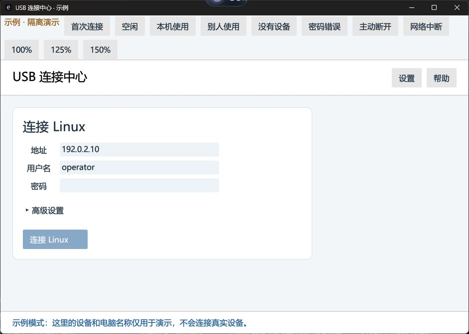
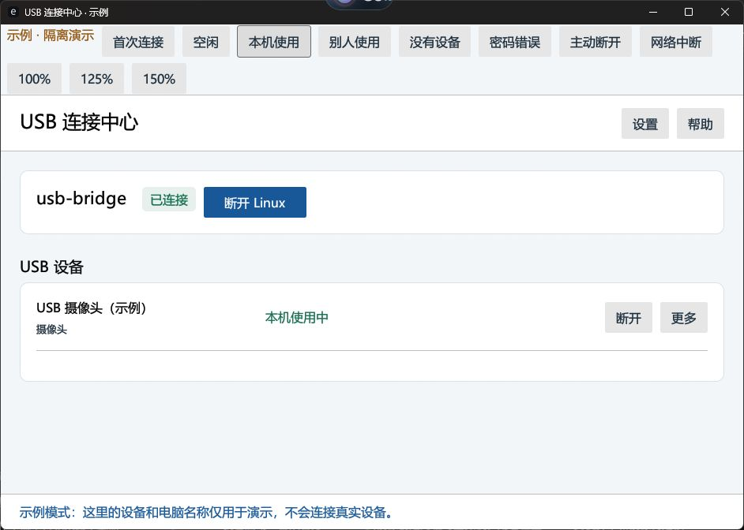

# Pair, connect and use USB devices

[中文](../zh-CN/usage.md) · [Installation](installation.md)

Screenshots below were captured from this release in isolated demo mode; the demo selector toolbar is not shown in the normal installed client. All displayed addresses/devices are examples.

## First pairing

1. In **连接 Linux** (Connect Linux), enter the host's reachable IP/DNS name, its account name, and that account's password. The suggested username `operator` must be replaced if your actual account differs. Advanced settings contain SSH port (22) and service port (3241).
2. Click **连接 Linux**. On first contact, compare the displayed SSH fingerprint with `ssh-keygen -lf` output on the Linux console. A changed identity requires investigation rather than blindly accepting it.
3. After confirmation, SSH/sudo reads the host's enrollment data and the client obtains its own certificate. Passwords are used for this operation and are not saved in client settings. The host must already have the service installed.
4. The header showing Linux connected proves management access. Select an available device and click **连接**. Only **本机正在使用** (in use by this computer) indicates the device is attached locally; then open the original device application.

## Device ownership and switching computers

One physical USB device has one owner; composite interfaces move together. Computers A and B can use different devices from the same host. If another computer owns a device, ask its operator to finish and disconnect. **更多 → 管理员强制断开** requires a fresh Linux administrator password and confirmation of the specific device/session; it can interrupt the other computer and does not automatically take over the device.

For storage, safely eject it in Windows first. End device operations, then click that row's **断开**. To release all devices belonging to this computer and stop automatic host reconnection, click **断开 Linux** and confirm. Pairing is retained; other computers' devices are unaffected. This intentional disconnection survives restarting the app.

## Window and tray

Clicking **×** hides the window while connections continue. Single-click the **blue USB tray icon** (possibly under the taskbar's **^** overflow) to restore the same window. Right-click the icon → **退出客户端…** opens explicit exit choices: retain connections and exit the front end, or disconnect this computer's devices and exit. Closing the window is not a device release.

## Add another Windows computer

Install the client and repeat password enrollment independently. Alternatively the existing paired computer can create a one-time invitation under settings; save/import it on the new computer and complete **添加这台电脑**. Invitations expire after 15 minutes and may be used once. They are temporary credentials: send them only to the intended computer and do not post them in issues.

For manual CA/code enrollment, obtain `/opt/rust-usb-bridge/public/ca.pem` through a trusted channel, run `sudo /opt/rust-usb-bridge/usb-bridge-server pair-code --state-dir /var/lib/rust-usb-bridge`, and enter the CA/code in advanced pairing. The code rotates after successful pairing. A public CA is not a private key, but each deployment uses its own CA; no shared production identity is shipped.

## Updates, backup and uninstall

Download the new architecture-matched Linux package, verify it, release all devices, then run its installer again. It keeps identity and sharing configuration and saves the previous binary/unit under `/opt/rust-usb-bridge/backups/TIMESTAMP`. To restore that binary: `sudo bash /opt/rust-usb-bridge/rollback-linux.sh --backup TIMESTAMP`. Without `--backup`, rollback stops the bridge and restores its recorded USB bindings. Uninstall: `sudo bash /opt/rust-usb-bridge/uninstall-linux.sh`; private identity state is retained for intentional reinstallation.

Back up `/var/lib/rust-usb-bridge` locally with root-only permissions while the service is stopped after devices are released. Never upload that archive. Restore only to the same intended host, not as an image template for multiple machines. Back up Windows private state using administrator access when the service is stopped. Losing a host's private identity requires re-pairing; changing only its network address does not.

Windows updates use the new setup executable after this computer releases its sessions. The complete Windows bundle contains both Linux payloads; the Linux updater verifies the remote architecture before selecting one. You can also use the architecture-matched offline Linux package. Export logs under settings when reporting failures and remove private details before sharing them. See [troubleshooting](troubleshooting.md).
